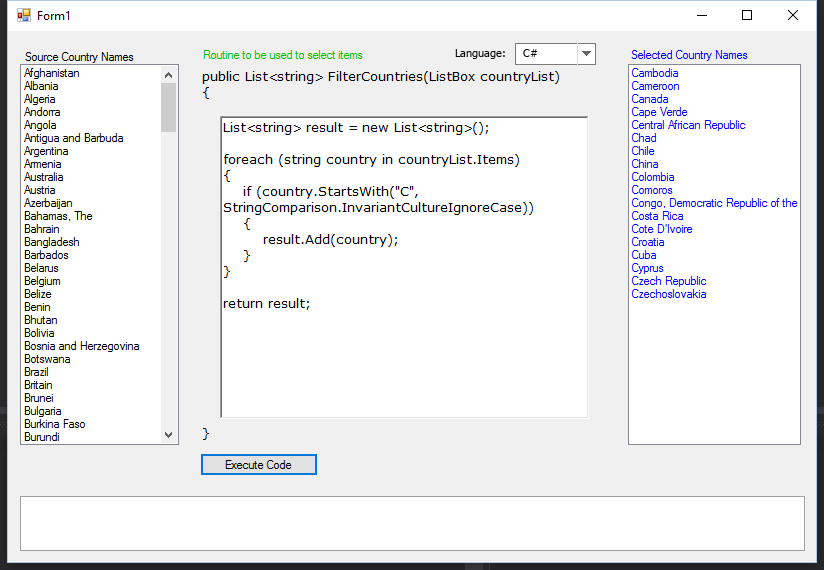
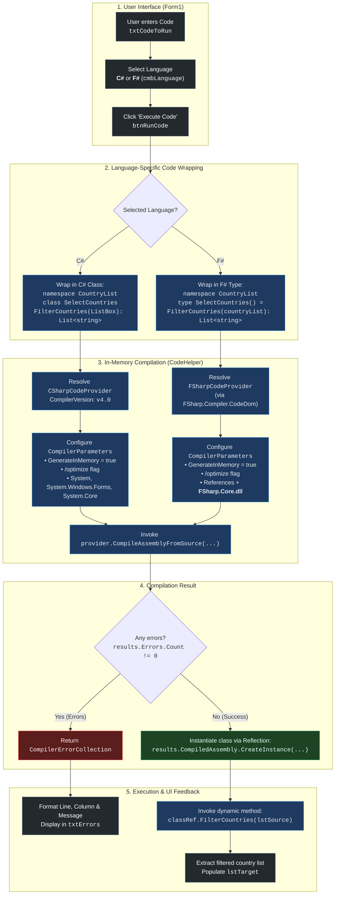
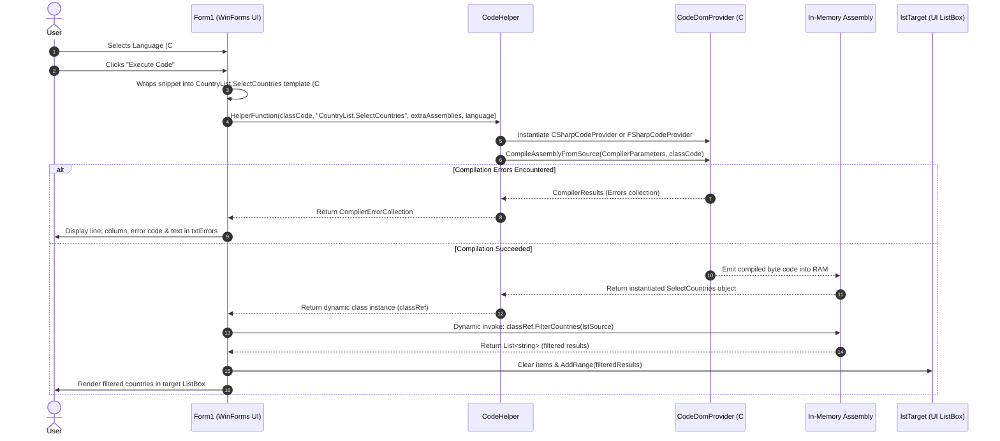

# ⚡ Dynamically Execute Code .NET (DynCode) - C# & F#

[](https://dotnet.microsoft.com/)
[](https://docs.microsoft.com/dotnet/csharp/)
[](https://fsharp.org/)
[](https://docs.microsoft.com/dotnet/desktop/winforms/)
[](LICENSE)

A Windows Forms application demonstrating how to **compile and execute C# and F# code dynamically at runtime** in memory using `System.CodeDom.Compiler`, `Microsoft.CSharp.CSharpCodeProvider`, and `FSharp.Compiler.CodeDom.FSharpCodeProvider`.

Select your language (**C#** or **F#**), write custom filtering logic directly in the user interface, compile into an in-memory assembly without writing files to disk, and immediately execute against live data.

---

## 📸 Application Screenshot



The application features an intuitive left-to-right processing pipeline:
1. **Source Country Names (Left)**: The raw input list of items.
2. **Routine & Language Selector (Middle)**: Select between **C#** and **F#**, customize the filtering routine directly in the editor, and click **Execute Code**.
3. **Selected Country Names (Right)**: The dynamic filtered results populated immediately by the in-memory compiled assembly.
4. **Compiler Diagnostics (Bottom)**: Live error console providing line, column, error code, and diagnostic messages for syntax or compilation errors.

---

## 🔄 Code Execution Process

The system compiles user-provided C# or F# code snippets entirely in memory, instantiates the dynamically generated class, and executes the filter method against UI controls via dynamic reflection.

### High-Level Execution Flow



---

### Sequence Diagram



---

## ⚙️ How It Works Under the Hood

### 1. Template Code Wrapping

#### C# Template
```csharp
using System;
using System.Windows.Forms;
using System.Collections.Generic;

namespace CountryList
{
    public class SelectCountries
    {
        public List<string> FilterCountries(ListBox countryList)
        {
            // <-- C# USER CODE INJECTED HERE -->
        }
    }
}
```

#### F# Template
```fsharp
namespace CountryList

open System
open System.Windows.Forms
open System.Collections.Generic

type SelectCountries() =
    member this.FilterCountries(countryList: ListBox) : List<string> =
        // <-- F# USER CODE INJECTED HERE (INDENTED) -->
```

---

### 2. In-Memory Dynamic Compilation

[CodeHelper.cs](file:///Users/alekseiprokopov/DinamiclyExecuteCode.NET/CodeHelper.cs) orchestrates the compilation pipeline:

- **Provider Resolution**:
  - **C#**: Uses `CSharpCodeProvider(new Dictionary<string, string> { { "CompilerVersion", "v4.0" } })`.
  - **F#**: Uses `FSharp.Compiler.CodeDom.FSharpCodeProvider` (resolved dynamically via reflection or `CodeDomProvider.CreateProvider("fs")`).
- **In-Memory Assemblies**: `CompilerParameters.GenerateInMemory = true` keeps compilation inside RAM with zero temporary disk artifacts.
- **Reference Resolution**:
  - Both: `system.dll`, `System.Windows.Forms.dll`, `System.Core.dll`.
  - F#: Automatically includes `FSharp.Core.dll` and `mscorlib.dll`.

---

### 3. Diagnostics & Error Handling
If syntax or type errors occur, `CodeHelper` returns the `CompilerErrorCollection`. The UI parses:
- **Line number**
- **Column number**
- **Error code** (e.g. `CS1002` in C# or `FS0039` in F#)
- **Error description**

and renders them in `txtErrors`.

---

### 4. Dynamic Invocation
Regardless of whether C# or F# was used, the compiled assembly exposes the same contract:
```csharp
dynamic classRef = CodeHelper.HelperFunction(classCode, "CountryList.SelectCountries", new object[] { }, language);
List<string> targetValues = classRef.FilterCountries(lstSource);
```

---

## 💡 Code Examples

### C# Starter Snippet
```csharp
List<string> result = new List<string>();

foreach (string country in countryList.Items)
{
    if (country.StartsWith("C", StringComparison.InvariantCultureIgnoreCase))
    {
        result.Add(country);
    }
}

return result;
```

### F# Starter Snippet
```fsharp
let result = new List<string>()

for item in countryList.Items do
    let country = string item
    if country.StartsWith("C", StringComparison.InvariantCultureIgnoreCase) then
        result.Add(country)

result
```

### F# Functional / Pipeline Snippet
```fsharp
countryList.Items
|> Seq.cast<obj>
|> Seq.map string
|> Seq.filter (fun c -> c.StartsWith("C", StringComparison.InvariantCultureIgnoreCase))
|> ResizeArray
```

> **Tip**: In F#, `ResizeArray<'T>` is an alias for `System.Collections.Generic.List<'T>`, seamlessly matching the expected method signature.

---

## 📂 Project Structure

```text
DinamiclyExecuteCode.NET/
├── CodeHelper.cs         # Unified C# and F# CodeDom compilation engine
├── Form1.cs              # UI logic, language switching & dynamic execution
├── Form1.Designer.cs     # Windows Forms layout (includes cmbLanguage dropdown)
├── Form1.resx            # WinForms UI resources
├── Program.cs            # WinForms application entry point
├── App.config            # .NET runtime & system.codedom F# provider configuration
├── DynCode.csproj        # Visual Studio C# Project (.NET 4.5, PackageReferences)
├── DynCode.sln           # Visual Studio Solution
├── Screenshot.png        # UI preview screenshot
├── LICENSE               # MIT License
└── readme.md             # Project documentation & Mermaid execution diagrams
```

---

## 🚀 Getting Started

### Prerequisites
- Windows OS
- [.NET Framework 4.5](https://dotnet.microsoft.com/download/dotnet-framework/net45) or higher
- Visual Studio 2012 or newer / Rider / MSBuild
- NuGet packages restored:
  - `FSharp.Core` (4.7.2+)
  - `FSharp.Compiler.CodeDom` (1.0.0.1)

### Building & Running

1. **Clone the repository:**
   ```bash
   git clone https://github.com/roboter/DinamiclyExecuteCode.NET.git
   ```

2. **Open the solution:**
   - Open `DynCode.sln` in Visual Studio.
   - NuGet packages (`FSharp.Core` & `FSharp.Compiler.CodeDom`) will restore automatically.

3. **Run the application:**
   - Press <kbd>F5</kbd>.
   - Switch between **C#** and **F#** using the **Language** dropdown.
   - Click **Execute Code** to compile and run on the fly!

---

## 📄 License

This project is licensed under the MIT License - see the [LICENSE](LICENSE) file for details.