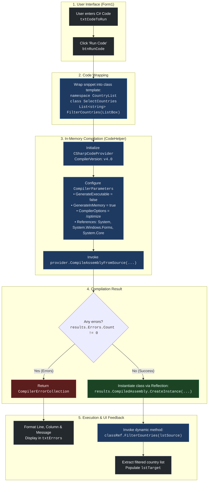
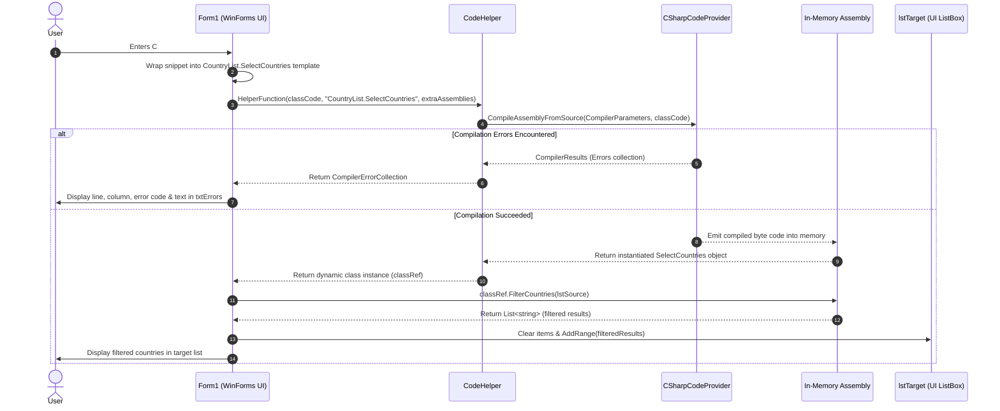

# ⚡ Dynamically Execute Code .NET (DynCode)

[](https://dotnet.microsoft.com/)
[](https://docs.microsoft.com/dotnet/csharp/)
[](https://docs.microsoft.com/dotnet/desktop/winforms/)
[](LICENSE)

A Windows Forms application demonstrating how to **compile and execute C# code dynamically at runtime** in memory using `System.CodeDom.Compiler` and `Microsoft.CSharp.CSharpCodeProvider`.

Write custom filtering logic or algorithms directly in the user interface, compile them into an in-memory assembly without touching the disk, and immediately execute the resulting code against live data.

---

## 📸 Application Screenshot


---

## 🔄 Code Execution Process

The system compiles user-provided C# code snippets in memory, dynamically instantiates the generated class, and executes methods against UI data.

### High-Level Execution Flow



---

### Sequence Diagram



---

## ⚙️ How It Works Under the Hood

### 1. Template Code Wrapping
The user's code snippet is wrapped inside a complete C# class structure inside [Form1.cs](file:///Users/alekseiprokopov/DinamiclyExecuteCode.NET/Form1.cs#L21-L47):

```csharp
using System;
using System.Windows.Forms;
using System.Collections.Generic;

namespace CountryList
{
    public class SelectCountries
    {
        public List<string> FilterCountries(ListBox countryList)
        {
            // <-- USER CODE INJECTED HERE -->
        }
    }
}
```

### 2. In-Memory Dynamic Compilation
[CodeHelper.cs](file:///Users/alekseiprokopov/DinamiclyExecuteCode.NET/CodeHelper.cs#L8-L51) configures the C# compiler:

- **`GenerateInMemory = true`**: Generates the assembly purely in RAM without producing persistent `.dll` files on disk.
- **`CompilerVersion = "v4.0"`**: Utilizes the modern compiler provider version.
- **`CompilerOptions = "/optimize"`**: Enables compiler optimizations.
- **Assembly References**: Automatically links default assemblies (`system.dll`, `System.Windows.Forms.dll`, `System.Core.dll`), plus any optional caller-specified assemblies.

### 3. Diagnostics & Error Handling
If syntax or compilation errors occur, `CodeHelper` returns the `CompilerErrorCollection`. The UI parses each error's:
- **Line number**
- **Column number**
- **Error code** (e.g. `CS1002`)
- **Error description**

and prints them directly into the error console textbox.

### 4. Late-Bound Dynamic Execution
Using C#'s `dynamic` keyword, the application invokes the method without requiring a pre-compiled shared interface:

```csharp
dynamic classRef = CodeHelper.HelperFunction(classCode, "CountryList.SelectCountries", new object[] { });
List<string> targetValues = classRef.FilterCountries(lstSource);
```

---

## 💡 Example Snippet

Here is the default snippet demonstrating how to filter listbox items:

```csharp
List<string> result = new List<string>();

foreach (string country in countryList.Items)
{
    // Filter countries starting with 'C' (case-insensitive)
    if (country.StartsWith("C", StringComparison.InvariantCultureIgnoreCase))
    {
        result.Add(country);
    }
}

return result;
```

---

## 📂 Project Structure

```text
DinamiclyExecuteCode.NET/
├── CodeHelper.cs         # Core compilation logic using CSharpCodeProvider & CodeDom
├── Form1.cs              # Main UI logic, snippet wrapper & dynamic invocation
├── Form1.Designer.cs     # Windows Forms layout & component initialization
├── Form1.resx            # WinForms UI resources & default starter snippet
├── Program.cs            # WinForms application entry point
├── DynCode.csproj        # Visual Studio C# Project configuration (.NET 4.5)
├── DynCode.sln           # Visual Studio Solution
├── Screenshot.png        # UI preview screenshot
├── LICENSE               # MIT License
└── readme.md             # Project documentation & execution architecture
```

---

## 🚀 Getting Started

### Prerequisites
- Windows OS
- [.NET Framework 4.5](https://dotnet.microsoft.com/download/dotnet-framework/net45) or higher
- Visual Studio 2012 or newer / Rider / MSBuild

### Building & Running

1. **Clone the repository:**
   ```bash
   git clone https://github.com/roboter/DinamiclyExecuteCode.NET.git
   ```

2. **Open the solution:**
   - Double-click `DynCode.sln` to open in Visual Studio.

3. **Build & Run:**
   - Press <kbd>F5</kbd> or click **Start** in Visual Studio.
   - Enter or modify the C# code in the text box.
   - Click **Run Code** to compile and execute on the fly!

---

## 📄 License

This project is licensed under the MIT License - see the [LICENSE](LICENSE) file for details.